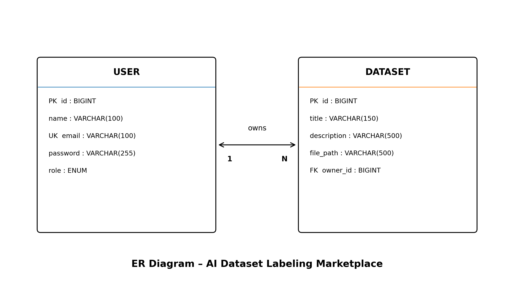

# Entity-Relationship Diagram

The ER diagram matches the six JPA entities currently implemented in the backend. Every relationship has its foreign key identified. Hibernate manages schema updates in local development.

Editable Graphviz source: `diagrams/er-diagram.dot`.

## Relationships
- One user owns many datasets and creates many projects.
- One dataset may be referenced by many projects.
- One project contains many tasks.
- One user can be assigned many tasks as an annotator.
- One task may have many annotations.
- One annotation may have many reviews.
- One user can create many reviews as a reviewer.
